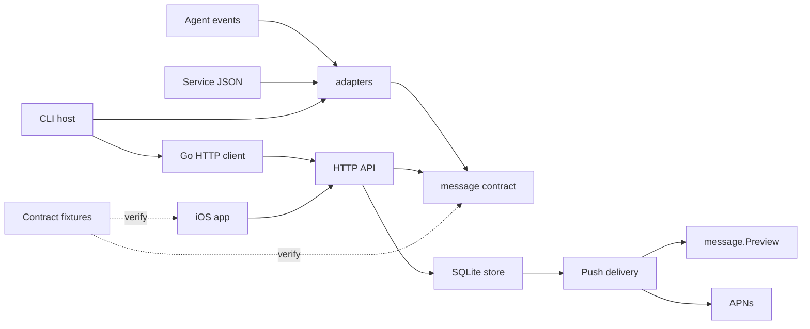

# Meow notification modules

Meow uses one V1 notification contract for agents, CI jobs, monitors and ordinary services. The existing `/v1/notifications` endpoint and CLI commands remain compatible. This refactor adds no database migration, mandatory version field, external dependency or runtime plugin loader.

## Module boundaries

| Module | Owns | Does not own |
| --- | --- | --- |
| `message/` | Sender request, stored wire record, context, defaults, validation, canonical idempotency representation, banner preview | Credentials, HTTP, files, database, agent event schemas |
| `adapters/` | External event decoding, common event/origin, agent title/body policy, event filtering and deduplication | Environment, filesystem, network, secrets, retries |
| `cli/cmd/meow/` | Flags/stdin, environment/config, optional local session-name lookup, setup/migration, retry/logging, invoking adapters and client | Copies of the notification protocol or agent parsers |
| `client/` | HTTP, bearer authentication, transport errors, typed request/response | Agent-specific parsing or display policy |
| `server/internal/api/` | Authentication/scopes, HTTP input/status, idempotency header, standard validation, domain-to-wire presentation | Another notification model or another set of notification limits |
| `server/internal/store/` | Device isolation, serialized writes, SQLite/domain records, retention | External agent payloads or notification formatting |
| `server/internal/push/` | Direct/relay delivery, APNs payload limits, retry/status | Original-body rewriting or agent-specific interpretation |
| `ios/Shared/`, app views | Swift wire model, origin identity, local storage/search, Markdown/detail presentation, notification hydration | Provider payload parsing or APNs secrets |
| `contracts/` | JSON Schema and frozen cross-language compatibility fixtures | Runtime state or credentials |



`client.NotifyRequest` is an alias of `message.Notification`; `client.Notification` and the API response use `message.Record`. Store structs deliberately remain separate because device/key ownership and internal delivery data are not part of the public wire model. The legacy question summary remains readable in records; V1 senders use only `info` and `alert`.

## Notification contract

Machine-readable schema: [notification-v1.schema.json](../contracts/notification-v1.schema.json). It describes normalized requests and stored records (`$defs.record`). Normalize raw input before checking normalized length constraints. The endpoint remains `/v1/notifications`; the API path supplies the version.

```json
{
  "title": "Deployment completed",
  "body": "**All tests passed.**\nReady for the next step.",
  "source": "CI",
  "type": "info",
  "priority": "normal",
  "context": {
    "workspace": "meow",
    "workspace_id": "repo:AmazingAng/meow",
    "session": "Release checks",
    "session_id": "workflow-run-123"
  }
}
```

| Field | Meaning / normalized limit |
| --- | --- |
| `title` | Required human-readable event title; 1–256 Unicode code points |
| `body` | Original UTF-8 Markdown/plain text; optional, up to 4000 code points. JSON or code may be stored as a string. Never send an object as `body`. |
| `source` | Optional agent/service display label, up to 64 code points. It is not an authentication identity. |
| `type` | `info` or `alert`; omitted/empty defaults to `info`. `alert` means attention is needed, not that a task succeeded or failed. |
| `priority` | `low`, `normal`, `high`; omitted/empty defaults to `normal`. Delivery interruption level is separate from event type. |
| `context` | Optional object: `workspace` / `session` labels up to 200 code points, `workspace_id` / `session_id` identities up to 128. Values are trimmed, single-line and contain no control characters. |

`message.Notification.Normalize` trims title/body/source/context, supplies defaults, validates limits and returns independent context without changing caller-owned data. Unknown JSON fields are ignored for forward compatibility. Input JSON has a 64 KiB HTTP/service budget; native agent events have a separate 1 MiB adapter budget before being condensed into a standard notification.

Names are display labels; IDs retain identity across renames. Use stable IDs to distinguish identically named workspaces/sessions. No identity is inferred from a title or body. Agent workspace paths are hashed before transmission; optional session-name file lookup belongs to the CLI host. Generic service JSON is already explicit and does not trigger local agent metadata lookup.

The original body is preserved by the server. `message.Preview` renders only a banner preview: at most 180 code points and three lines, with complete JSON objects/arrays and fenced code omitted from the banner. Swift preview compatibility remains checked by shared fixtures. Inbox/Markdown detail presentation is a separate layer.

## Service integration

A service that can send standard JSON needs no custom adapter.

```sh
# notification.json contains the standard object above.
meow send --json --idempotency-key "ci-run-123" < notification.json

# The same payload can be sent without installing the CLI.
curl --fail-with-body "$MEOW_SERVER/v1/notifications" \
  -H "Authorization: Bearer $MEOW_KEY" \
  -H "Content-Type: application/json" \
  -H "Idempotency-Key: ci-run-123" \
  --data-binary @notification.json
```

`meow send --json` also accepts one quoted JSON argument. It retains normal nonzero CLI errors and supports `--quiet` and `--idempotency-key`. Content flags (`--title`, `--source`, `--priority`, context flags, etc.) cannot be mixed with JSON; the JSON object is authoritative. `MEOW_SERVER` / `MEOW_KEY` still configure the transport. Plain `meow send` and its environment defaults remain supported.

For Go services:

```go
notification := message.Notification{
    Title: "Backup completed", Source: "Backup service",
    Body: "Snapshot stored successfully.",
    Context: &message.Context{Session: "Nightly backup", SessionID: "backup-123"},
}
normalized, err := notification.Normalize()
if err != nil { return err }
_, err = client.New(serverURL, deviceKey).Notify(ctx, normalized, "backup-123")
return err
```

`Idempotency-Key` is a transport header, not a JSON field or a session ID. Reuse it only for retries of the same event/payload; use a new key for a new event. It accepts up to 128 non-space printable ASCII characters. The API fingerprints `Notification.CanonicalJSON()` after normalization, preserving the old V1 byte representation and retries created before session context existed. Native agent adapters retain their previous event/body-based hook keys. Events without a stable event identity receive one per-invocation key in the CLI, reused for transport attempts.

## Agent adapters

Built-ins:

| Adapter | Input | Meaning |
| --- | --- | --- |
| `claude-stop` | Claude event JSON on stdin | New result; does not imply success |
| `claude-failure` | StopFailure event JSON | Runtime/API error |
| `claude-notify` | Notification event JSON | Attention needed, including permission/form prompts |
| `codex` | Legacy notify JSON as final argument | Completed turn |
| `codex-stop` | Lifecycle event JSON on stdin | New result; retains existing temporary-suggestion filtering |
| `codex-permission` | Lifecycle event JSON on stdin | Attention needed |
| `generic` | Standard notification JSON | Service-provided title/body/type/context; body is retained |

`adapters.Adapter.Decode` returns `(Event, send, error)`. `send=false, error=nil` means an intentionally ignored event. Errors are malformed inputs. `adapters.Adapt` applies size/object checks, optional host context resolution, title/summary policy, validation and deduplication. `adapters.Build(name, ...)` selects a built-in adapter. `Options` explicitly supplies language, summary policy and the optional context resolver; adapters never read environment variables.

To add a Go integration, implement the small interface and reuse the common pipeline:

```go
type CIAdapter struct{}

func (CIAdapter) Decode(input []byte) (adapters.Event, bool, error) {
    var run struct { ID, Job, Summary string }
    if err := json.Unmarshal(input, &run); err != nil {
        return adapters.Event{}, false, err
    }
    if run.ID == "" { return adapters.Event{}, false, fmt.Errorf("run ID is required") }
    return adapters.Event{
        Notification: message.Notification{
            Title: "CI result", Body: run.Summary, Source: "CI",
        },
        Origin: adapters.Origin{SessionID: run.ID, SessionName: run.Job},
        DedupeNamespace: "ci", EventID: run.ID,
    }, true, nil
}

result, err := adapters.Adapt(CIAdapter{}, input, adapters.Options{})
if err != nil { return err }
if !result.Send { return nil }
_, err = sender.Notify(ctx, result.Notification, result.IdempotencyKey)
return err
```

Leave `Template` empty to retain service titles and full bodies. Agent adapters may select `ResultTitle`, `AttentionTitle` or `FailureTitle` and use `IncludeSummary` / `Language`. A new built-in agent also needs one `Lookup` registration and agent-specific setup wiring; it does not need server, database or iOS provider-specific code. Registration is explicit in source; there is no global mutable plugin registry.

## Verification

Run `python3 -B scripts/verify_notification_modules.py --output <new-output-directory>`. It uses existing Go/Swift/Xcode tools and no new dependencies. It runs standard Go tests with race/shuffle, core coverage and fault injection, native Swift contract/logical tests, a generic iOS SDK compile and a real isolated CLI/server loopback check. It never installs onto an iPhone or launches a simulator.

Frozen native adapter outputs and idempotency keys were captured before extraction: [agent-notifications.json](../contracts/fixtures/agent-notifications.json). Shared request/record fixtures: [notifications.json](../contracts/fixtures/notifications.json). Swift contract tests decode the same records and round-trip them through the local cache representation. Public JSON Schema shape and limits are checked against the Go models; the test harness does not claim to implement a complete JSON Schema validator.

The server image uses an explicit build context: `go.mod`, `go.sum`, `message/` and `server/`. `client/` and agent adapters are not server runtime dependencies. When adding a server dependency, keep `Dockerfile` and `.dockerignore` aligned with the Go module graph; a local Go build alone cannot detect an omitted Docker source directory.
