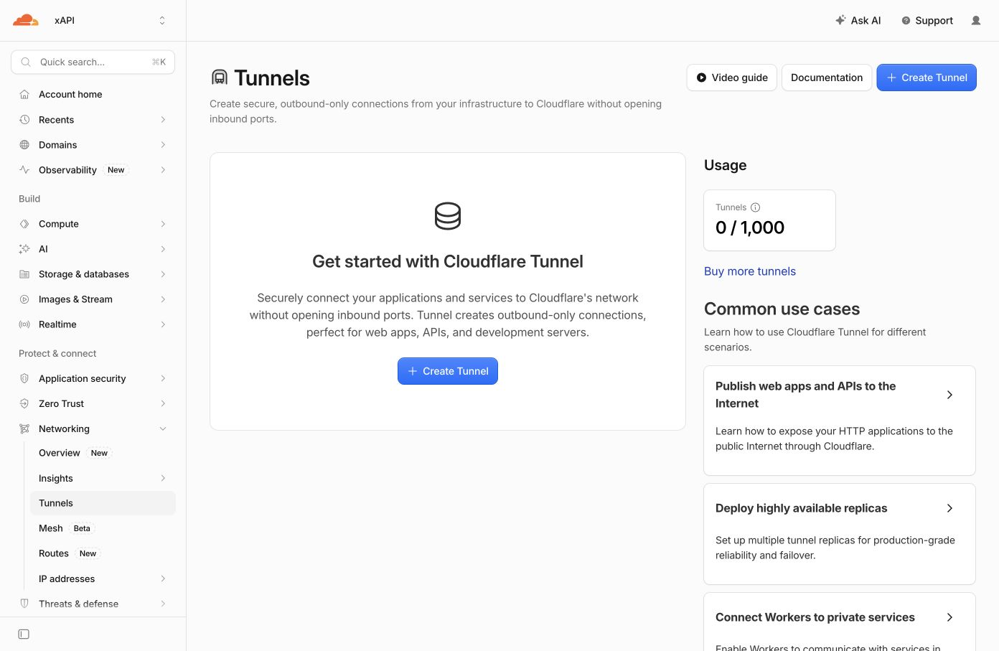

# Compose + Caddy 本机部署验证

日期：2026-10-18。按用户最后确认，本次完成本机 Docker 验证，域名接入留后。

## 结论

通过：镜像构建、原始 Caddyfile 配置校验、容器健康检查、HTTP → HTTPS、
HTTPS/HTTP2 反向代理、真实 Linux CLI、主要 API 流程、容器重建持久化、在线备份恢复。

测试域名为 `meow.blue`，客户端将连接地址覆盖到 `127.0.0.1`，仍保留该域名的
Host、SNI 和证书主机名校验。仅将 Caddy 的证书签发器替换为本地 CA；没有使用
`curl -k`，没有安装系统根证书。这证明本机 TLS 链路可用，不代表公网 ACME 已通过。

当前容器继续运行，Caddy 只发布 `127.0.0.1:80/443`，Meow 的 8080 未发布。
使用独立数据库卷，没有迁移手机测试环境或覆盖 CLI 登录配置。

## 实际检查

- 构建：Docker Desktop，`linux/arm64`，Go 1.27.2，Meow UID 65532，Caddy 2.11.4。
- 注册得到一组隔离测试凭证；无凭证返回 401，Device Key 访问手机 API 返回 403。
- 通知创建及幂等重放；收件箱、未读数、已读和送达回执。
- 待处理筛选及计数；60 秒长轮询等待后被批准唤醒。
- 回复必须使用设备凭证和 Idempotency-Key；重试返回同一结果，冲突回复返回 409。
- 超过期限回复返回 410，状态为 expired；取消返回 cancelled。
- 强制重建两个容器后，原测试凭证、回答、已读/送达时间仍可读取。
- 运行服务器在线 backup 命令；以快照的独立数据库路径启动第二个服务器，
  通过原测试凭证读取相同历史。快照完整性检查通过，无外键错误，目标问题只有一条回复。
- 实际编译 Linux Meow CLI，在独立临时容器中通过 Caddy HTTPS 执行 whoami 和 send，均退出 0。
- 伪造 X-Forwarded-For 请求经 Caddy 后，后端记录真实代理连接地址而非伪造值。
- APNs 密钥从仓库外只读挂载，非 root 服务成功加载；没有给测试设备注册 APNs token。
- 缺失密钥时直接报挂载错误，未创建错误的宿主机目录。

## 修正

- `MEOW_APNS_KEY_PATH` 支持使用仓库外的绝对密钥路径。
- 文件挂载设置 `create_host_path: false`，避免错误路径被 Docker 创建为目录。
- Caddy 等 Meow 健康后启动，避免首次启动时先接收请求。
- 补充部署、权限、在线备份及恢复说明；增加可重复运行的 API 验证脚本。

额外复现了 Linux 权限问题：root 拥有、mode 600 的文件不能被 UID 65532 读取。
部署说明采用 mode 700 的私有父目录和 mode 444 的密钥副本；原始下载文件权限不变。
只读挂载不会改变 Linux 文件读取权限。

## 本机复现

以下配置和凭证在本机私有目录，不提交到仓库：

`/Users/liang/.config/meow/compose-verification/`

其中 `.env` 配置 APNs 参数和密钥绝对路径，`compose.local.yaml` 将端口限制在回环地址，
并挂载 `Caddyfile.local`。该 Caddyfile 与原始反向代理配置相同，仅增加 `tls internal`。

从仓库根目录运行：

```sh
docker compose \
  --env-file "$HOME/.config/meow/compose-verification/.env" \
  -p meow-deploy-verify -f deploy/compose.yaml \
  -f "$HOME/.config/meow/compose-verification/compose.local.yaml" up -d --wait

curl --noproxy '*' \
  --cacert "$HOME/.config/meow/compose-verification/caddy-root.crt" \
  --resolve meow.blue:443:127.0.0.1 https://meow.blue/healthz

python3 scripts/verify_deployment.py persistence \
  --base-url https://meow.blue --connect-ip 127.0.0.1 \
  --ca "$HOME/.config/meow/compose-verification/caddy-root.crt" \
  --state-dir "$HOME/.config/meow/compose-verification/final-api-check"
```

重新执行完整测试时，将最后一条命令的 `persistence` 改成 `exercise`，并指定新的私有
`--state-dir`；该操作会新建测试设备。匿名注册限流仍然生效。

## 边界及清理

本次没有验证公网证书签发、DNS 公网访问、amd64 构建，或 Docker 部署的真机推送。
测试脚本调用的 delivered 接口是 API 验证，不是真实通知显示的证明。

Cloudflare xAPI 的 `meow.blue` 原本没有 DNS 记录，本次未修改 DNS。
在用户选择稍后接入前创建了一个无路由、无连接的测试 Tunnel；随后已删除，
刷新确认 Tunnel 数为 0。恢复测试容器已移除，仅保留本机 Meow 和 Caddy。



证据文件：

- `compose-caddy-results.json`：结构化检查结果，不含凭证。
- `compose-build.log`：镜像构建记录。
- `compose-recreate.log`：重建及健康依赖顺序。
- `compose-api-checks.log`：API、重建、恢复及 HTTP 响应头。
- `compose-caddy-config.log`：原始 Caddyfile 校验结果。

私有目录中的测试凭证、APNs 密钥及数据库备份未写入这些证据文件。
